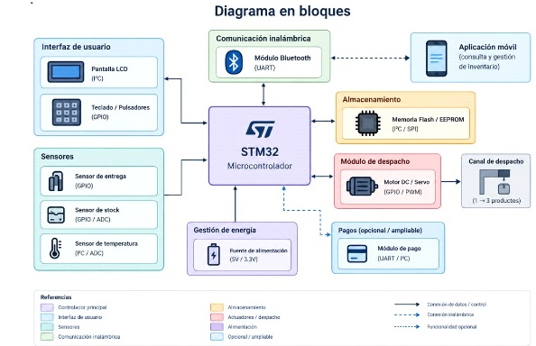

# Propuesta de Proyecto Final: Máquina Expendedora Inteligente

**Universidad de Buenos Aires — Facultad de Ingeniería**  
**Asignatura:** Taller de Sistemas Embebidos (TdSE)  
**Periodo:** 2do Cuatrimestre de 2026  
**Fecha Límite de Entrega (Deadline):** Semana 11 de cursada  

---

## Información del Equipo

* **Autores:** 
  * Delle Coste Mateo (Padrón: 112543)
  * Guerrero Deivy (Padrón: 110420)
  * Pomato Alan (Padrón: 94721)

---

## Control de Entregas y Normas del Repositorio
* **Modalidad de actualización:** Asentar y modificar los detalles de la entrega en este archivo (`Propuesta.md`) antes de realizar la creación o integración de cada *branch*.
* **Formato:** Markdown estándar para renderizado directo en GitHub.

---

## 1. Selección del Proyecto a Implementar

### 1.1. Objetivo del Proyecto y Resultados Esperados
El objetivo de este proyecto es diseñar e implementar una máquina expendedora automática de productos envasados, que permita seleccionar y adquirir productos, controlar su despacho y mantener actualizado el inventario. 

Además, se busca incorporar una interfaz de usuario y una aplicación móvil que permita consultar el estado del sistema, las ventas realizadas y gestionar la reposición de productos. El desarrollo se realizará de forma progresiva, comenzando con un canal de despacho y buscando ampliar posteriormente su capacidad hasta ofrecer tres productos diferentes.

---

### 1.2. Proyectos Similares
En base al objetivo del proyecto, se proponen tres alternativas de máquina expendedora con distintos niveles de alcance, considerando la complejidad de implementación y las funcionalidades previstas:

1. **Máquina expendedora básica:** Un único canal de despacho, con selección de productos, control de inventario y detección de entrega. Se implementarán las funciones esenciales de venta automática.
2. **Máquina expendedora escalable:** Se comenzará con un canal de despacho funcional y se buscará ampliar progresivamente el sistema hasta ofrecer tres productos. Se incorporarán la configuración de precios y la gestión remota del inventario y las ventas mediante una aplicación móvil.
3. **Máquina expendedora avanzada:** Se implementarán tres canales de despacho desde el inicio, junto con funcionalidades ampliadas de gestión y registro de operaciones.

Para comparar estas alternativas, se tienen en cuenta seis aspectos característicos, ponderados del 1 al 10:

* **Disponibilidad del hardware (10):** Facilidad para conseguir los componentes necesarios en el mercado local.
* **Funcionalidad e impacto del proyecto (9):** Aporte de las funciones implementadas a la experiencia de compra y a la gestión de la máquina.
* **Dificultad técnica y viabilidad (10):** Complejidad de implementación e integración dentro del tiempo disponible para el trabajo.
* **Costo (5):** Costo estimado de los componentes y materiales necesarios.
* **Escalabilidad (9):** Facilidad para incorporar nuevos canales de despacho y funcionalidades.
* **Interés personal (7):** Motivación del equipo para desarrollar el proyecto y aplicar los conocimientos adquiridos en la materia.

#### Tabla 1.2: Comparación de Alternativas de Proyecto

| Criterio (Ponderación) | Máquina Básica (Pts) | Máquina Básica (Pond) | Máquina Escalable (Pts) | Máquina Escalable (Pond) | Máquina Avanzada (Pts) | Máquina Avanzada (Pond) |
| :--- | :---: | :---: | :---: | :---: | :---: | :---: |
| **Disponibilidad del hardware (10)** | 10 | 100 | 9 | 90 | 8 | 80 |
| **Funcionalidad e impacto (9)** | 7 | 63 | 9 | 81 | 9 | 81 |
| **Dificultad técnica y viabilidad (10)** | 7 | 70 | 8 | 80 | 5 | 50 |
| **Costo (5)** | 10 | 50 | 9 | 45 | 6 | 30 |
| **Escalabilidad (9)** | 3 | 27 | 10 | 90 | 7 | 63 |
| **Interés personal (7)** | 6 | 42 | 9 | 63 | 8 | 56 |
| **Puntaje Total** | | **352** | | **449** | | **360** |

---

### 1.3. Selección del Proyecto
Considerando los resultados de la Tabla 1.2, se selecciona la **Alternativa 2: Máquina expendedora escalable**. Esta opción presenta un equilibrio entre la funcionalidad esperada, la viabilidad de implementación y la posibilidad de ampliar el sistema.

A diferencia de la alternativa básica, permite proyectar una solución con mayores prestaciones y posibilidades de crecimiento. Por otro lado, comenzar con tres canales de despacho desde el inicio incrementaría la complejidad de integración y las necesidades de hardware.

Por este motivo, se propone implementar inicialmente un canal de despacho, verificar su funcionamiento y luego ampliar el sistema hasta alcanzar tres productos, manteniendo una arquitectura modular que facilite futuras modificaciones.

---

### 1.3.1. Diagrama en Bloques
A continuación se esquematiza la arquitectura general del sistema y la interconexión entre el microcontrolador STM32, la interfaz de usuario, los sensores, actuadores y los módulos de comunicación.

---

## 2. Elicitación de Requisitos y Casos de Uso

Actualmente en Argentina existen soluciones comerciales de máquinas expendedoras inteligentes (como las ofrecidas por Vendify y Smart Vending) que incorporan selección de productos, sistemas de pago digital, monitoreo remoto del inventario y consulta de ventas. 

Frente a estas soluciones, este proyecto propone desarrollar un prototipo de menor escala y costo de implementación, cuya arquitectura modular permita comenzar con un canal de despacho y ampliar progresivamente su capacidad hasta tres productos. Asimismo, el desarrollo propio brinda flexibilidad para adaptar el hardware y el software a las necesidades del sistema.

### 2.1. Requisitos del Proyecto

| Grupo | ID | Descripción |
| :--- | :---: | :--- |
| **Compra** | **1.1** | El sistema permitirá seleccionar un producto mediante la interfaz local. |
| | **1.2** | El sistema verificará la disponibilidad del producto antes de habilitar la compra. |
| | **1.3** | El sistema permitirá confirmar la compra mediante un mecanismo de pago simulado. |
| | **1.4** | Una vez confirmada la compra, el sistema accionará el mecanismo de despacho correspondiente. |
| **Despacho** | **2.1** | El sistema contará con un mecanismo motorizado para entregar los productos seleccionados. |
| | **2.2** | El sistema contará con un sensor óptico para detectar la salida del producto. |
| | **2.3** | El inventario se actualizará únicamente cuando se confirme la entrega del producto. |
| | **2.4** | Si no se detecta la entrega dentro del tiempo establecido, el sistema detendrá el mecanismo e informará la falla. |
| **Interfaz e Indicadores** | **3.1** | El sistema contará con botones para seleccionar productos y confirmar operaciones. |
| | **3.2** | El sistema contará con un joystick analógico para navegar por los menús. |
| | **3.3** | El sistema contará con un display para mostrar productos, precios, disponibilidad y mensajes de estado. |
| | **3.4** | El sistema contará con LEDs y un buzzer para indicar estados de funcionamiento y fallas. |
| **Configuración y Almacenamiento** | **4.1** | El sistema permitirá configurar los precios de los productos mediante un modo de configuración. |
| | **4.2** | La configuración se almacenará en la memoria Flash interna del microcontrolador. |
| | **4.3** | El sistema recuperará la configuración almacenada al iniciar. |
| **Comunicación y Aplicación** | **5.1** | El sistema se comunicará con una aplicación móvil mediante Bluetooth Low Energy, utilizando el módulo HM-10. |
| | **5.2** | La aplicación permitirá consultar el inventario, las ventas registradas y la recaudación acumulada. |
| | **5.3** | La aplicación permitirá registrar la reposición de productos y actualizar el inventario. |
| | **5.4** | El sistema enviará a la aplicación el resultado de las operaciones solicitadas. |

---

### 2.2. Casos de Uso

#### CU-01: Compra de un Producto
| Elemento | Definición |
| :--- | :--- |
| **Disparador** | El usuario desea comprar uno de los productos ofrecidos por la máquina. |
| **Precondiciones** | La máquina está encendida y se encuentra en modo NORMAL. El producto seleccionado tiene unidades disponibles. |
| **Flujo Principal** | 1. El usuario selecciona un producto. 2. El sistema informa su precio y solicita la confirmación de compra. 3. El usuario confirma el pago simulado. 4. El sistema acciona el mecanismo de despacho. 5. El sensor óptico detecta la salida del producto. 6. El sistema actualiza el inventario y registra la venta. 7. El display informa que la operación finalizó correctamente. |
| **Flujos Alternativos** | **a.** Si el producto no tiene stock, el sistema informa que no está disponible y no permite continuar con la compra. **b.** Si no se detecta la salida del producto dentro del tiempo establecido, el sistema detiene el mecanismo, señaliza la falla y no registra la operación como una venta exitosa. |

#### CU-02: Configuración de Precios
| Elemento | Definición |
| :--- | :--- |
| **Disparador** | El operador desea modificar el precio de uno de los productos. |
| **Precondiciones** | La máquina está encendida y el operador puede acceder al modo `SET_UP`. |
| **Flujo Principal** | 1. El operador ingresa al menú de configuración. 2. Selecciona el producto cuyo precio desea modificar. 3. Introduce el nuevo precio mediante la interfaz local. 4. El sistema valida el valor ingresado. 5. El operador confirma la modificación. 6. El sistema guarda el nuevo precio en la memoria Flash interna y confirma la operación. |
| **Flujos Alternativos** | **a.** Si el precio ingresado no es válido, el sistema informa el error y solicita un nuevo valor. **b.** Si no se confirma la modificación, el sistema conserva el precio anterior. |

#### CU-03: Consulta de Ventas y Reposición de Inventario
| Elemento | Definición |
| :--- | :--- |
| **Disparador** | El operador desea consultar el inventario o registrar la reposición de productos desde la aplicación móvil. |
| **Precondiciones** | La máquina está encendida y la aplicación móvil está conectada al módulo HM-10 mediante Bluetooth. |
| **Flujo Principal** | 1. El operador solicita desde la aplicación la información del inventario. 2. El sistema envía el stock disponible, las ventas registradas y la recaudación acumulada. 3. El operador selecciona el producto que desea reponer e introduce la cantidad agregada. 4. La aplicación envía la solicitud al STM32. 5. El sistema valida la cantidad y actualiza el inventario. 6. La aplicación informa el resultado de la operación. |
| **Flujos Alternativos** | **a.** Si no se establece o se pierde la conexión Bluetooth, la operación no puede completarse y la aplicación informa el inconveniente. **b.** Si la cantidad ingresada no es válida, el sistema rechaza la actualización y comunica el error al operador. |